# Project

A full-stack application with a backend API (REST + GraphQL) and a frontend client.

## Documentation

- [Getting Started](docs/guides/getting-started.md)
- [Backend Service Map](backend/docs/service-map.md)
- [API Reference](docs/api/README.md) — external REST/GraphQL reference, versioning and deprecation policy
- [Contracts](contracts/README.md)

## API Reference

The external API reference for the backend REST and GraphQL endpoints is published under [`docs/api/`](docs/api/README.md). It is generated from the existing backend route and schema definitions and includes the versioning and deprecation policy for external consumers.

## Repository Layout

## Workspace Status

Not every top-level directory is built the same way. The table below records the
maintenance status of directories whose role is not obvious from the build scripts.

| Directory             | Status       | Notes |
|-----------------------|--------------|-------|
| `zk/`                 | Experimental | Zero-knowledge proof subsystem. Not built in root CI. Open HIGH-priority audit items in [`zk/CIRCUIT_AUDIT.md`](zk/CIRCUIT_AUDIT.md) tracked by issue #1327. Keep in place until the audit closes. |
| `mobile/quarantine/`  | Active       | Triage list for flaky Maestro E2E flows. Read by `mobile/scripts/run-tests.sh`; do not archive. See [`mobile/quarantine/README.md`](mobile/quarantine/README.md). |

Archived work, if any, lives under [`docs/archive/`](docs/archive/) with a status
note explaining why it was parked.

## 🏗️ Architecture

The Stellar-Save system consists of four main layers that work together to provide a decentralized ROSCA experience:



### Architecture Components

- **User Layer**: Users interact with the system through Stellar wallets (Freighter, Lobstr, Albedo)
- **Frontend Layer**: React + TypeScript SPA with Vite, Material-UI components, and React Query for state management
- **Blockchain Layer**: Stellar network with Soroban smart contracts managing groups, contributions, and payouts
- **Data Layer**: On-chain storage, Stellar Horizon API for transaction history, and Soroban events for real-time updates

### Key Data Flows

1. **Group Creation**: User → Frontend → Contract → On-chain Storage → Events → UI Update
2. **Contribution**: User → Frontend → Contract → Escrow → Storage → Events → UI Update
3. **Payout**: User → Frontend → Contract → Escrow → Recipient → Storage → Events → UI Update

For detailed architecture documentation, see [docs/architecture.md](docs/architecture.md).

## 🚀 Features

- **Create Groups**: Set contribution amount, cycle duration, and max members
- **Join & Participate**: Members join and contribute each cycle
- **Automatic Payouts**: When all members contribute, payout executes automatically to the next recipient
- **Native XLM Support**: Built-in support for Stellar Lumens (XLM)
- **Token Ready**: Architecture supports custom Stellar tokens (roadmap item)
- **Transparent**: All contributions and payouts are verifiable on-chain

## 🛠️ Quick Start & Workspace Guides

To get started quickly, follow the dedicated setup guides for each component of the Stellar-Save monorepo:

- 🚀 **Smart Contracts**: See [contracts/stellar-save/src/lib.rs](contracts/stellar-save/src/lib.rs) and the [QUICK_REFERENCE.md](docs/reference/quick-reference.md) for smart contract API documentation.
- 💻 **Frontend Web App**: See [frontend/README.md](frontend/README.md) for React/TypeScript setup, environment configuration (`VITE_*`), MUI theme tokens, and local development commands.
- 📱 **Mobile Application**: See [mobile/README.md](mobile/README.md) for Expo React Native setup, iOS/Android emulator instructions, and mobile architecture.
- 🛠️ **Scripts & Tooling**: See [scripts/README.md](scripts/README.md) for build (`build.sh`), test (`test.sh`), and deployment (`deploy_testnet.sh`, `deploy_mainnet.sh`) scripts.
- ⚙️ **Backend Service**: See [backend/README.md](backend/README.md) for server setup, environment variables schema, and indexer configuration.

### Common Development Commands

```bash
# Clone the repository
git clone https://github.com/Xoulomon/Stellar-Save.git
cd Stellar-Save

# Install workspace dependencies & git hooks (pnpm is the only supported package manager)
corepack enable
pnpm install

# Build Soroban smart contracts
./scripts/build.sh

# Run all test suites across smart contracts and web frontend
./scripts/test.sh
create_group(contribution_amount, cycle_duration, max_members) -> u64
get_group(group_id) -> Group
list_members(group_id) -> Vec<Address>
join_group(group_id)
is_member(group_id, address) -> bool
  
contribute(group_id, member, amount)
get_contribution_status(group_id, cycle_number) -> Vec<(Address, bool)>
execute_payout(group_id)
is_complete(group_id) -> bool
pause_group(group_id, caller)    // Creator-only: halt contributions & payouts
unpause_group(group_id, caller)  // Creator-only: resume contributions & payouts

## Handsoff notes

<!-- handsoff-issue-2107 -->
- #2107: [Testing] Remove redundant duplicated tests
